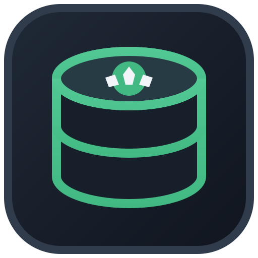

# PES 2017 EDITOR — PES 2017 Database Editor



Editor desktop independente para inspeção e edição experimental dos dados do Pro Evolution Soccer 2017 para Windows. O projeto não possui vínculo oficial com a Konami.

[](https://github.com/xXxjubeixXx/PES2017EDITOR/actions/workflows/ci.yml)

## Estado da versão

`0.3.0` — Fase 03: motor CPK/BIN e primeira edição experimental.

A versão estável publicada anterior é [`v0.2.1`](https://github.com/xXxjubeixXx/PES2017EDITOR/releases/tag/v0.2.1). A v0.3.0 permanece experimental até a validação visual dentro do jogo e a reconstrução geral de CPK serem concluídas.

## Funcionalidades verificadas

- detecção da instalação do PES 2017, Data, download, DpFileList, patches e saves;
- leitura de cabeçalho CPK e TOCs CRI UTF diretas ou mascaradas;
- transformação `DecryptUTF` para TOCs mascaradas, sem redistribuir DLL externa;
- indexação real dos 55 CPKs da instalação de referência, com 40.505 entradas;
- ContentOffset/TocOffset efetivo para leitura física das entradas;
- cache SQLite em `%LOCALAPPDATA%\\PES2017EDITOR`;
- parser WESYS com zlib e payload direto;
- leitura real de 13.053 jogadores, 521 times, 62 competições e 12.977 associações;
- relacionamento comprovado entre IDs de jogadores, times e PlayerAssignment;
- edição do nome de um jogador em cópia experimental do `dt10_win.cpk`;
- reabertura e validação do CPK gerado, preservando o CPK original;
- backup SHA-256 antes da geração da cópia experimental;
- explorador CPK, pesquisa, virtualização e extração individual;
- interface WPF/MVVM em português brasileiro, tema escuro e navegação modular;
- verificação e atualização por releases GitHub, herdadas da Fase 02.

## Limites explícitos

A escrita atual usa uma cópia layout-preserving: substitui somente um slot existente quando o novo WESYS cabe nele. Ainda não há reconstrução geral de TOC/ITOC/ETOC/GTOC, criação de novas entradas, edição de atributos esportivos, criação de registros, precedência in-game comprovada ou validação visual no jogo. Nenhuma dessas funções é apresentada como concluída.

## Requisitos

Para usuários: Windows 10/11 x64. O pacote publicado é self-contained e não exige SDK/runtime .NET, Python, Java, SQLite separado ou ferramentas externas de CPK.

Para desenvolvimento: Windows x64, .NET SDK 10.x, PowerShell, Git e Inno Setup 6 para gerar o instalador. Os testes marcados `Proprietary` exigem os arquivos locais do PES e não devem ser publicados.

## Compilar e testar

```powershell
& 'C:\Program Files\dotnet\dotnet.exe' restore .\PES2017Editor.sln
& 'C:\Program Files\dotnet\dotnet.exe' build .\PES2017Editor.sln -c Release --no-restore
& 'C:\Program Files\dotnet\dotnet.exe' test .\PES2017Editor.sln -c Release --no-restore
pwsh .\scripts\publish.ps1
pwsh .\scripts\build-installer.ps1
```

O processo de distribuição está documentado em [`docs/RELEASE_PROCESS.md`](docs/RELEASE_PROCESS.md). Artefatos locais ficam em `artifacts/` e são bloqueados pelo `.gitignore`.

## Dados e segurança

O editor não altera automaticamente a instalação do PES 2017. Configurações, cache, logs, instalações recentes, backups e projetos ficam em `%LOCALAPPDATA%\\PES2017EDITOR`. O salvamento da Fase 03 gera uma cópia experimental e nunca grava no CPK original.

Arquivos proprietários do jogo, saves, backups, tokens, certificados privados, DLLs sem licença e artefatos de compilação não são publicados. SHA-256 verifica integridade, mas não autentica a identidade do publicador; Authenticode ainda não está configurado.

## Arquitetura

O código é separado em `Core`, `Cpk`, `Binary`, `Database`, `Game`, `Infrastructure`, `App` e `Updater`. A interface não manipula bytes diretamente. O contrato `ICpkArchiveBackend` mantém o núcleo desacoplado de futuros backends nativos ou auxiliares.

## Documentação

- [`docs/PHASE_03_REPORT.md`](docs/PHASE_03_REPORT.md)
- [`docs/CPK_FORMAT.md`](docs/CPK_FORMAT.md)
- [`docs/BINARY_FORMATS.md`](docs/BINARY_FORMATS.md)
- [`docs/GAME_DATABASE.md`](docs/GAME_DATABASE.md)
- [`docs/ENGINE_REVERSE_FINDINGS.md`](docs/ENGINE_REVERSE_FINDINGS.md)
- [`docs/TEST_RESULTS.md`](docs/TEST_RESULTS.md)
- [`docs/KNOWN_LIMITATIONS.md`](docs/KNOWN_LIMITATIONS.md)
- [`docs/PROJECT_STATUS.md`](docs/PROJECT_STATUS.md)
- [`docs/INSTALLER.md`](docs/INSTALLER.md)
- [`docs/UPDATE_SYSTEM.md`](docs/UPDATE_SYSTEM.md)
- [`docs/RELEASE_PROCESS.md`](docs/RELEASE_PROCESS.md)

O licenciamento do código autoral permanece pendente de decisão do proprietário do projeto.
